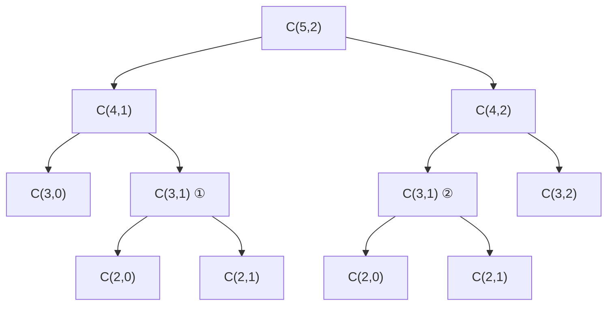

# Лабораторная работа № 7

**МИНИСТЕРСТВО НАУКИ И ВЫСШЕГО ОБРАЗОВАНИЯ**  
**РОССИЙСКОЙ ФЕДЕРАЦИИ**

Федеральное государственное бюджетное образовательное учреждение  
высшего образования  
«______________________________»

Кафедра ________________________________

---

# ЛАБОРАТОРНАЯ РАБОТА № 7

по дисциплине «Основы алгоритмизации и программирование»

Рекурсивные алгоритмы и динамическое программирование  
в задачах комбинаторной оптимизации

## Вариант 6

| | |
|---|---|
| Направление | 38.03.05 «Бизнес-информатика» |
| Курс | 2 |
| Выполнил | студент группы БИ 2-1 |
| ФИО | Голдаева Валерия Валентиновна |
| Проверил | ___________________________ |
| Год | 2026 |

---

## 1. Цель работы и формулировка задания

**Цель работы:** изучить метод динамического программирования как способ устранения повторных вычислений в рекурсивных алгоритмах и экспериментально сопоставить трудоёмкость трёх реализаций одной задачи — наивной рекурсивной, рекурсивной с мемоизацией и итеративной.

**Задание варианта 6:**

| Параметр | Значение |
|---|---|
| Задача А | Биномиальный коэффициент $C(n,k)$, $n$ до 28 |
| Три реализации | Наивная рекурсия, мемоизация, итеративная |
| Задача Б | Максимальная сумма подотрезка, массив из 10 000 чисел |
| Доп. | **Г6** — сравнить свою мемоизацию с `functools.lru_cache` |

---

## 2. Рекуррентные соотношения

### 2.1. Биномиальный коэффициент

$$
C(n,k)=\begin{cases}
0, & k<0\ \text{или}\ k>n,\\
1, & k=0\ \text{или}\ k=n,\\
C(n-1,k-1)+C(n-1,k), & \text{иначе}.
\end{cases}
$$

Слагаемые — число способов выбрать $k$ элементов из $n$, где фиксированный элемент либо входит в выборку ($C(n-1,k-1)$), либо нет ($C(n-1,k)$).

### 2.2. Максимальная сумма подотрезка

$$
D[i]=\max\bigl(a[i],\ D[i-1]+a[i]\bigr),\qquad
\text{ответ}=\max_i D[i].
$$

$D[i]$ — лучшая сумма среди подотрезков, **оканчивающихся** в позиции $i$.

---

## 3. Дерево рекурсии $C(5,2)$

Наивная рекурсия для $C(5,2)$ даёт 19 вызовов; при мемоизации — 13.  
Повторяются, в частности, $C(3,1)$, $C(2,1)$, $C(2,0)$.



---

## 4. Листинг (с пояснениями)

Полный код: `lab7-variant6/main.py`.

### 4.1. Наивная рекурсия

```python
def binom_naive(n, k):
    global calls
    calls += 1
    if k < 0 or k > n: return 0
    if k == 0 or k == n: return 1
    return binom_naive(n-1, k-1) + binom_naive(n-1, k)
```

### 4.2. Мемоизация

```python
def binom_memo(n, k, cache=None):
    global calls
    calls += 1
    if cache is None: cache = {}
    if k < 0 or k > n: return 0
    if k == 0 or k == n: return 1
    key = (n, k)
    if key in cache: return cache[key]   # уже считали
    cache[key] = binom_memo(n-1, k-1, cache) + binom_memo(n-1, k, cache)
    return cache[key]
```

### 4.3. Итеративная формула

```python
def binom_iter(n, k):
    if k < 0 or k > n: return 0
    k = min(k, n - k)
    res = 1
    for i in range(1, k + 1):
        res = res * (n - k + i) // i
    return res
```

### 4.4. Максимальная сумма подотрезка + восстановление

```python
def max_subarray(arr):
    best = cur = arr[0]
    best_l = best_r = cur_l = 0
    for i in range(1, len(arr)):
        if cur + arr[i] < arr[i]:
            cur = arr[i]; cur_l = i
        else:
            cur += arr[i]
        if cur > best:
            best, best_l, best_r = cur, cur_l, i
    return best, best_l, best_r
```

---

## 5. Результаты измерений

### 5.1. Биномиальный коэффициент $C(n,\,n/2)$

| $n$ | $k$ | Наивная, с | Вызовов | Мемо, с | Вызовов | Итер., с | lru, с | $C(n,k)$ |
|---:|---:|---:|---:|---:|---:|---:|---:|---:|
| 10 | 5 | 0,0000 | 503 | 0,000013 | 51 | 0,000004 | 0,000010 | 252 |
| 15 | 7 | 0,0012 | 12 869 | 0,000031 | 113 | 0,000004 | 0,000017 | 6 435 |
| 18 | 9 | 0,0081 | 97 239 | 0,000169 | 163 | 0,000004 | 0,000026 | 48 620 |
| 20 | 10 | 0,0326 | 369 511 | 0,000073 | 201 | 0,000008 | 0,000031 | 184 756 |
| 22 | 11 | 0,1432 | 1 410 863 | 0,000066 | 243 | 0,000008 | 0,000062 | 705 432 |
| 24 | 12 | — | — | 0,000473 | 289 | 0,000005 | 0,000172 | 2 704 156 |
| 26 | 13 | — | — | 0,000076 | 339 | 0,000003 | 0,000049 | 10 400 600 |
| 28 | 14 | — | — | 0,000084 | 393 | 0,000002 | 0,000074 | 40 116 600 |

Наивная рекурсия при $n>22$ не измерялась (время существенно больше 1 с).  
Рост числа вызовов наивной версии согласуется с экспонентой.

### 5.2. Г6: своя мемоизация vs `lru_cache`

| $n$ | Своя memo, с | Вызовов | lru_cache, с |
|---:|---:|---:|---:|
| 20 | 0,000042 | 201 | 0,000036 |
| 24 | 0,000058 | 289 | 0,000039 |
| 28 | 0,000079 | 393 | 0,000051 |

`lru_cache` чуть быстрее (реализация на C). Семантика та же: каждая подзадача один раз.

### 5.3. Максимальная сумма подотрезка ($n=10\,000$)

| Показатель | Значение |
|---|---|
| Оптимальная сумма | 255 879 |
| Границы | [2 .. 9998], длина 9997 |
| Проверка `sum(arr[L:R+1])` | 255 879 |
| Время | ≈ 0,0015 с |

---

## 6. Выводы

1. Наивная рекурсия $C(n,k)$ экспоненциальна: при $n=22$ уже > 1,4 млн вызовов; при $n\ge 24$ непригодна.
2. Мемоизация сводит число вызовов к $O(nk)$ различных состояний (для $k=n/2$ — сотни при $n\le 28$).
3. Итеративная формула через произведение — $O(k)$ и $O(1)$ памяти, самая быстрая.
4. **Г6:** `lru_cache` семантически эквивалентен своей мемоизации и обычно быстрее за счёт C-реализации.
5. Максимальная сумма подотрезка решается за $\Theta(n)$ с восстановлением границ (алгоритм Кадане).
6. Динамическое программирование устраняет повторные вычисления там, где подзадачи перекрываются.

---

*Конец отчёта*
